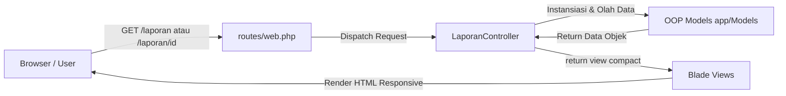

# Sistem Kehilangan & Temuan Barang di Lingkungan Kampus
### Tugas Pertemuan 7: Routing, Controller & Blade Template Engine (Laravel 13 MVC)

Proyek ini adalah implementasi lanjutan dari model OOP Pertemuan 5 (**Sistem Kehilangan dan Temuan Barang di Lingkungan Kampus**) yang dipindahkan dan diintegrasikan secara penuh ke dalam arsitektur **Laravel MVC** (Model-View-Controller) dengan template engine **Blade**.

---

## Identitas Mahasiswa & Akademik
- **Nama Mahasiswa**: Julian Atha Maulana
- **NIM**: 20251020052
- **Kelas / Prodi**: TI - S1 / Teknik Informatika
- **Mata Kuliah**: Pemrograman Berorientasi Objek (TI033015)
- **Dosen Pengampu**: Hilman Lesmana, S.T., M.S.F.
- **Institusi**: Fakultas Teknologi Informasi, Universitas Catur Insan Cendekia (UCIC)
- **Tahun Akademik**: 2026/2027

---

## 1. Alur Arsitektur Route, Controller, dan Blade
Pada pertemuan sebelumnya (Pertemuan 5), seluruh class OOP digabung dalam satu file PHP murni dan hasilnya hanya dicetak ke terminal (CLI). Pada Pertemuan 7 ini, kode program dipecah secara sistematis mengikuti standar arsitektur MVC Laravel:



1. **Bagian Model (`app/Models/`)**:
   - Class-class dari Pertemuan 5 dipisahkan menjadi file model mandiri di `app/Models/`:
     - `BisaDicocokkan.php`: Interface kontrak kemampuan pencocokan teks (`kunciPencocokan()`).
     - `Barang.php`: Komponen objek fisik barang yang dilaporkan hilang atau ditemukan.
     - `Laporan.php`: Abstract class sebagai kerangka bersama semua laporan (mengelola status, atribut dasar, dan method `ringkas()`).
     - `LaporanKehilangan.php`: Subclass yang mewarisi `Laporan` (Inheritance *is-a*), menambahkan identitas `namaPelapor`.
     - `LaporanTemuan.php`: Subclass yang mewarisi `Laporan` dan meng-override method `masaBerlaku()` menjadi 90 hari.
     - `Klaim.php`: Class relasi komposisi (*has-a*) yang menghubungkan laporan kehilangan dan temuan, serta memverifikasi kecocokan barang menggunakan interface `BisaDicocokkan`.
   - Method disesuaikan agar mengembalikan nilai (*return values*) sehingga dapat dirender dinamis di template Blade.

2. **Bagian Route (`routes/web.php`)**:
   - Seluruh endpoint URL didaftarkan secara terstruktur menggunakan *Named Routes*:
     - Route praktikum: `/laporan` (daftar semua laporan).
     - Route praktikum dengan parameter wajib: `/laporan/{id}` (melihat detail satu laporan).
     - Route tugas rumah dengan parameter opsional: `/klaim/{status?}` (simulasi dan filter hasil klaim barang).

3. **Bagian Controller (`app/Http/Controllers/LaporanController.php`)**:
   - Bertindak sebagai pengatur alur lalu lintas data (*traffic manager*).
   - Menyiapkan instansiasi objek OOP secara in-memory (karena materi database dipelajari setelah UTS sesuai RPS).
   - Menangkap parameter dari URL (baik wajib `{id}` maupun opsional `{status?}`).
   - Memilih view Blade yang sesuai dan mengirimkan data melalui array / `compact()`.

4. **Bagian View Blade (`resources/views/`)**:
   - `layouts/app.blade.php`: Kerangka master layout dengan navigasi responsif, header identitas UCIC, subheader mahasiswa, `@yield('content')`, dan footer.
   - `laporan/index.blade.php`: Halaman tabel daftar laporan memanfaatkan directive `@foreach`, badge status dengan directive `@if`, dan link detail.
   - `laporan/show.blade.php`: Halaman kartu detail satu objek laporan berdasarkan parameter URL `{id}`.
   - `laporan/klaim.blade.php`: Halaman simulasi pencocokan klaim barang dengan tombol filter status (`semua`, `cocok`, `ditolak`, `selesai`) memanfaatkan directive `@forelse` / `@empty`.

---

## 2. Tabel Pemetaan Route

| HTTP Method | URI / Path | Route Name | Controller Action | Kategori | Fungsi Halaman |
| :--- | :--- | :--- | :--- | :--- | :--- |
| `GET` | `/` | - | Closure (Redirect) | Navigasi | Mengarahkan halaman awal otomatis ke `/laporan`. |
| `GET` | `/laporan` | `laporan.index` | `LaporanController@index` | Praktikum | Menampilkan tabel seluruh laporan kehilangan dan temuan (Polymorphism). |
| `GET` | `/laporan/{id}` | `laporan.show` | `LaporanController@show` | Praktikum | Menampilkan detail spesifik satu laporan sesuai parameter wajib `{id}`. |
| `GET` | `/klaim/{status?}` | `laporan.klaim` | `LaporanController@klaim` | Tugas Rumah | Menampilkan simulasi klaim barang dan memfilter berdasarkan parameter opsional `{status?}`. |

---

## 3. Pemenuhan Poin Praktikum & Tugas Rumah Individu (Slide 26)

| Syarat Tugas | Status | Keterangan Penerapan di Kode |
| :--- | :---: | :--- |
| **Tambahkan satu halaman** | **Terpenuhi** | Dibuat halaman `resources/views/laporan/klaim.blade.php` untuk simulasi klaim barang. |
| **Buat minimal satu route berparameter** | **Terpenuhi** | Dibuat route wajib `/laporan/{id}` dan route opsional `/klaim/{status?}` di `routes/web.php`. |
| **Gunakan Controller menyiapkan data** | **Terpenuhi** | `LaporanController.php` menginisialisasi objek `Barang`, `LaporanKehilangan`, `LaporanTemuan`, dan `Klaim`. |
| **Gunakan Blade `@if` dan `@foreach`** | **Terpenuhi** | Digunakan `@foreach` pada baris tabel laporan, `@forelse` pada kartu klaim, serta `@if` pada badge status. |
| **README & Dokumentasi Lengkap** | **Terpenuhi** | File `README.md` merinci arsitektur, kode, pengujian, dan bukti eksekusi. |

---

## 4. Cara Menjalankan Aplikasi

1. **Clone Repositori**:
   ```bash
   git clone https://github.com/JulianathaTI2/tugas-pbo-pertemuan-7.git
   cd tugas-pbo-pertemuan-7
   ```

2. **Instal Dependensi**:
   ```bash
   composer install
   ```

3. **Konfigurasi Environment**:
   Salin `.env.example` menjadi `.env` dan generate key:
   ```bash
   cp .env.example .env
   php artisan key:generate
   ```

4. **Jalankan Server Lokal**:
   ```bash
   php artisan serve
   ```
   Aplikasi dapat diakses melalui browser pada: `http://127.0.0.1:8000/laporan`

---

## 5. Skenario Pengujian & Bukti Eksekusi

1. **Pemeriksaan Route via Terminal (`php artisan route:list`)**:
   ```text
   GET|HEAD  / ................. routes/web.php
   GET|HEAD  klaim/{status?} ... laporan.klaim › LaporanController@klaim
   GET|HEAD  laporan ........... laporan.index › LaporanController@index
   GET|HEAD  laporan/{id} ...... laporan.show › LaporanController@show
   ```

2. **Pengujian Halaman Daftar (`http://127.0.0.1:8000/laporan`)**:
   - Menampilkan total 6 laporan (3 Kehilangan, 3 Temuan).
   - Menampilkan perbedaan masa simpan: `LaporanKehilangan` (30 hari default) vs `LaporanTemuan` (90 hari hasil override).

3. **Pengujian Halaman Detail (`http://127.0.0.1:8000/laporan/LK-001`)**:
   - Menangkap parameter `LK-001`.
   - Menampilkan komponen `Barang` (Dompet hitam), ciri-ciri, pelapor (Budi Santoso), dan output polimorfik `ringkas()`.

4. **Pengujian Halaman Tugas Rumah (`http://127.0.0.1:8000/klaim/cocok`)**:
   - Menangkap parameter opsional `cocok`.
   - Hanya menampilkan transaksi klaim yang statusnya cocok (`KL-001`), membuktikan loose coupling melalui interface `BisaDicocokkan`.
